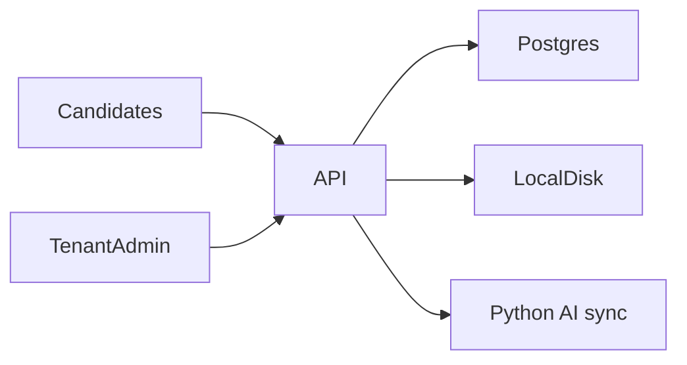
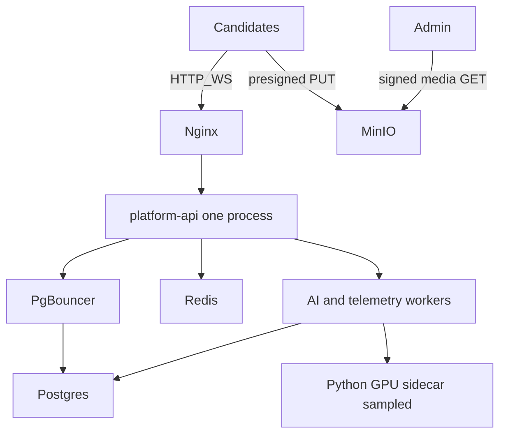

# ProctorShield — 10k Single-Instance Optimization

**Document Version:** 1.0  
**Date:** August 12, 2026  
**Product:** ProctorShield (Proctoring Service Platform)  
**Target Scale:** ~10,000 concurrent exam candidates on **one host stack**  
**Audience:** Managers (executive summary + appendix) and engineers (implementable sections)

This document is the 10k plan. For 100k–200k concurrent (Kubernetes, Aurora, Kafka, WS gateway fleet), see [ProctorShield-Production-Scaling-Guide.md](./ProctorShield-Production-Scaling-Guide.md). For the intended self-hosted compose stack, see [SELF-HOSTED-PRODUCTION.md](./SELF-HOSTED-PRODUCTION.md) — note the **scaffolded vs wired** gaps in §5.6.

---

## Table of Contents

1. [Executive Summary](#1-executive-summary)
2. [Current-State Analysis](#2-current-state-analysis)
3. [Target Single-Instance Architecture](#3-target-single-instance-architecture)
4. [AI / Model Optimization](#4-ai--model-optimization)
5. [Platform / API / Media / WebSocket](#5-platform--api--media--websocket)
6. [Page / Frontend Optimization](#6-page--frontend-optimization)
7. [Capacity Math](#7-capacity-math)
8. [Phased Rollout (4–6 Weeks)](#8-phased-rollout-4–6-weeks)
9. [Success Metrics / Acceptance](#9-success-metrics--acceptance)
10. [Manager Appendix](#10-manager-appendix)

---

## 1. Executive Summary

ProctorShield is a multi-tenant online exam proctoring platform: Node API, Python AI sidecar, candidate SDK, tenant admin, and super admin. Today it is **demo / internal-pilot ready** (~50–200 concurrent sessions per API process). Defaults will not survive a 10k exam day.

**Target:** 10,000 concurrent candidates on a **single instance** (one API process, Postgres, Redis, MinIO, sampled AI — not a 150k multi-pod fleet).

### Top 5 must-dos (ranked)

| Rank | Action | Why it is first |
|------|--------|-----------------|
| 1 | **MinIO direct uploads** — stop base64 recording chunks through Express | Media through the API is the first CPU/RAM/disk killer at 10k |
| 2 | **Client-first AI** — `serverAi=false` at exam scale; server ticks sampled or violation-triggered | Sync Python ticks cannot run at 2 Hz × 10k |
| 3 | **Async telemetry** — queue + batched face-check/event writes | Postgres pool `max: 20` exhausts on per-row inserts |
| 4 | **PgBouncer + admission** — wire unused `assertSessionAdmission` | Unbounded session accept causes cascade failure |
| 5 | **Admin page limits** — paginate snapshots; one live WebRTC view | Evidence/live pages can DDoS the API from a handful of proctors |

### Host sizing sketch (exam day)

| Role | Sketch |
|------|--------|
| API + workers (one Node process for WS) | 16–32 vCPU, 64–128 GB RAM |
| PostgreSQL 16 | Dedicated SSD / NVMe, PgBouncer in front |
| Redis | 8–16 GB (state, pub/sub, queues) |
| MinIO | Large NVMe; candidates PUT directly |
| AI (optional) | 1× GPU sibling, or CPU-only with **heavy sampling** |

Do not run a second API process for WebSockets until Redis pub/sub is wired into chat/signaling.

---

## 2. Current-State Analysis

### 2.1 Live path today

| Layer | What runs today |
|-------|-----------------|
| Candidate | Vite app + `@proctorshield/sdk`; `ExamWindow` defaults `serverAi=true`, `analyzeMinIntervalMs=500` |
| Tenant admin | Next.js :3200 — live poll + WebRTC; evidence panel loads snapshot blobs in parallel |
| API | Express monolith; pool `max: 20` in `services/platform-api/src/config/database.js` |
| Media | `POST /v1/sdk/sessions/:id/recording-chunk` with base64 → local `storage/` |
| AI | Sync HTTP to FastAPI `:5055` (`python/run_ai_server.py`) |
| Compose | Postgres only (`docker-compose.yml`, host port 15432) |

Documented capacity without these changes: **~50–200 sessions per API instance** ([Production Scaling Guide](./ProctorShield-Production-Scaling-Guide.md) §2).

### 2.2 Why the models feel “basic”

| Capability | Current implementation | Limitation |
|------------|------------------------|------------|
| Face presence (server) | MediaPipe Face Detection | Fine; still sync per tick |
| Pose / sideways | MediaPipe Face Mesh | Fine |
| Gaze (cheap) | Iris landmark ratios | Prefer this under load |
| Gaze (deep) | RetinaNet ResNet50-FPN, **forced CPU** | Expensive; every 2 ticks by default |
| Phone | YOLO11n, `PHONE_DETECTOR_FRAME_SKIP=1` (every frame) | Dominant CPU/GPU cost |
| Live identity | `InceptionResnetV1(pretrained="vggface2")` labeled “ArcFace”; Haar cascade detect | Not InsightFace ArcFace; Haar is weak vs MediaPipe |
| Legacy identity | Histogram + 24×24 patch in `python/proctoring/services/identity.py` | Not used on the live sidecar tick |
| Client face | Web Worker `FaceDetector` or luminance heuristic | Already the right 10k path |

Sync FastAPI `def` handlers block worker threads. There is no live batch API. Degradation levels exist in `services/platform-api/src/services/infra/degradation.js` (0 full → 3 skip server AI) but are **not wired into `/monitor-tick`**.

### 2.3 What breaks first at 10k (this phase)

Scaled down from [Production Scaling Guide §10](./ProctorShield-Production-Scaling-Guide.md#10-what-breaks-first-today):

1. **Recording through API** — camera + screen chunks into Node + local disk  
2. **Postgres writes** — face checks / events, pool of 20  
3. **Sync Python AI** — if `serverAi` stays on at 500 ms–2 s  
4. **In-memory WebSockets** — one process can hold ~10k sockets; a second process splits chat  
5. **API-key DB lookup** on every SDK request  
6. **Admission unused** — `assertSessionAdmission` is defined and never called  
7. **Admin evidence/live** — parallel blob fetches and many WebRTC feeds  

---

## 3. Target Single-Instance Architecture

**Rules for this phase**

- **One** `platform-api` process owns all WebSocket peers (~10k connections on a large box).
- Candidates upload **directly to MinIO** with short-lived presigned URLs; API only stores metadata.
- Server AI is **sampled or violation-triggered**, via queue — the API must not wait on YOLO/ArcFace.
- Redis holds session counters, API-key cache, BullMQ, and pub/sub (ready if a second process is added later).
- Horizontal API/WS fleets, Kafka, and Aurora replicas stay in the [150k guide](./ProctorShield-Production-Scaling-Guide.md). They are out of scope here.

---

## 4. AI / Model Optimization

Live tick path: SDK → `POST .../monitor-tick` → `runUnifiedProctorTick` → `POST /internal/analyze-session` → decode JPEG → resize ≤ `INFERENCE_MAX_WIDTH` (480) → MediaPipe → optional RetinaNet gaze → YOLO phone → optional identity.

### 4.1 Phased model plan

| Phase | Change | Why |
|-------|--------|-----|
| **P0** | Client Web Worker face default; `serverAi=false` at exam scale | Removes ~10k sync ticks/s |
| **P0** | Raise phone frame skip, deep-gaze every N, identity every N; wire `applyDegradationToTickOptions` into monitor-tick | Cut CPU per remaining tick |
| **P1** | Cache ArcFace **reference embedding once per session** | Halves identity work (today both faces are embedded each compare) |
| **P1** | Drop RetinaNet under load; landmark gaze only | RetinaNet is CPU-bound (`map_location="cpu"`) |
| **P1** | YOLO nano + lower `imgsz` (e.g. 192); OpenCV heuristic fallback under load | Phone is the heavy detector |
| **P2** | True async AI queue + GPU for YOLO/identity | Decouple API from inference |
| **P2** | Replace VGGFace2 + Haar with quantized ONNX InsightFace ArcFace + MediaPipe crop | Better accuracy and latency than the current “ArcFace” label |

P0 is mandatory for 10k. P1 is the model-quality upgrade without a GPU farm. P2 is the production AI path.

### 4.2 Env knobs already in `python/proctoring/config.py`

| Variable | Default | 10k exam-day target |
|----------|---------|---------------------|
| `PHONE_DETECTOR_FRAME_SKIP` | 1 | 3–5 |
| `PHONE_DETECTOR_IMAGE_SIZE` | 256 | 192 under load |
| `PHONE_DETECTOR_MAX_DIM` | 640 | 480 |
| `PHONE_DETECTOR_CONFIDENCE` | 0.10 | 0.25–0.35 (fewer false positives + less work) |
| `DEEP_GAZE_EVERY_N_TICKS` | 2 | 8–10, or disable (`run_deep_gaze: false`) |
| `IDENTITY_EVERY_N_TICKS` | 8 | 30+, or identity only on enroll / suspicion |
| `INFERENCE_MAX_WIDTH` | 480 | Keep; enforce smaller JPEG from client |
| `ARCFACE_DISTANCE_THRESHOLD` | 0.20 | Keep until model swap |
| `LIVE_MATCH_MIN_SIMILARITY` | 62 | Keep until model swap |

### 4.3 SDK / exam-window defaults to change

| Setting | Today | 10k exam day |
|---------|-------|----------------|
| `serverAi` | `true` in `apps/candidate-exam-app` and `ExamWindow` | `false` |
| `analyzeMinIntervalMs` | 500 | 30_000–60_000 if server AI is on at all |
| Client face Worker | ~10 s | Keep; 15–30 s at peak |
| Server AI trigger | Heartbeat + violations | **Violations only** |

`FaceCheckService` already supports `serverAi ?? false` and can escalate with `runServerAi('suspicious')`. The candidate app currently turns server AI **on**. Exam-scale config must override that.

### 4.4 Degradation (wire it)

From `degradation.js`:

| Level | Behavior |
|-------|----------|
| 0 | Full AI |
| 1 | Skip identity |
| 2 | Skip phone + deep gaze |
| 3 | Skip server AI (`skipServerAi`) |

Call `applyDegradationToTickOptions` on every monitor-tick. Drive the level from Redis (`system:ai_degradation_level`) when queue lag or CPU crosses thresholds.

### 4.5 Identity upgrade (why current matching is basic)

`python/proctoring/face_match/__init__.py` loads **FaceNet InceptionResnetV1 / VGGFace2**, detects with **Haar**, and compares cosine distance. Histogram signatures in `identity.py` are a separate, weaker helper.

Recommended replacement (P2): MediaPipe crop (already used for session analysis) → InsightFace / ONNX ArcFace embedding → **cache enrolled vector** in Redis or session state → live compare only. Keep the same API contract (`similarity` 0–100, streak mismatch).

---

## 5. Platform / API / Media / WebSocket

### 5.1 Media (highest leverage)

| Today | 10k target |
|-------|------------|
| `buildChunkSignaler` POSTs base64 to `/v1/sdk/sessions/:id/recording-chunk` | Presign → PUT to MinIO → metadata-only notify |
| `createUploadPresign` exists in `services/platform-api/src/storage/index.js` | Wire into SDK + routes |
| Local `storage/` | `STORAGE_BACKEND=s3` + MinIO :9000 |
| Chunk ~10 s, camera + screen | Chunk **20–30 s**; camera-only for non-coding exams |
| Playback via Express stream (`/v1/media/recordings/:id`) | Signed GET from MinIO/nginx; API auth for metadata only |

### 5.2 Database

- Put **PgBouncer** in front of Postgres. Keep app pool modest (10–20); do not open 500 direct connections.
- Batch face-check and event writes (multi-row `INSERT`, or queue → `telemetry-worker.mjs`).
- Cache hashed API keys in Redis (TTL 5–15 min). `findTenantByApiKey` must not hit Postgres on every SDK/WS request.

### 5.3 Admission

`services/platform-api/src/services/infra/admissionControl.js` implements `assertSessionAdmission(tenantId)` against `tenants.quotas.max_concurrent_sessions`. **It is never called.** Wire it on session init (and decrement on end). Use Redis counters when Redis is up.

Without this, 10k starts will all be accepted until Postgres and disk collapse.

### 5.4 Telemetry and AI workers

Scripts exist:

- `services/platform-api/scripts/ai-worker.mjs`
- `services/platform-api/scripts/telemetry-worker.mjs`
- `scripts/dev-prod-stack.mjs`

They are **not** in root `package.json` (`infra:up`, `worker:ai`, `worker:telemetry`, `dev:prod-stack` are missing). Finish wiring deps (`ioredis`, `bullmq`, S3 SDK, `prom-client`) and env (`AI_MODE=async`, `TELEMETRY_MODE=async`).

### 5.5 WebSockets and live video

- Keep **one** API process for 10k sockets.
- Wire Redis pub/sub (`wsPubSub.js`) into `chat.js` / session WS **before** adding a second process.
- Cap live proctor ratio (~1–5% of candidates watched at once). Prefer violation gallery + chat over many simultaneous WebRTC relays.
- Add coturn when live video must work behind NAT (config exists under `infra/coturn/`).

### 5.6 Scaffolded vs wired (do not assume SELF-HOSTED-PRODUCTION is live)

[SELF-HOSTED-PRODUCTION.md](./SELF-HOSTED-PRODUCTION.md) describes Redis, MinIO, PgBouncer, async modes, and `GET /health` fields. **Current repo gaps:**

| Claimed | Actual |
|---------|--------|
| `npm run infra:up` / `dev:prod-stack` / workers | Scripts on disk; **not** in root `package.json` |
| Compose: Postgres, Redis, MinIO, PgBouncer | `docker-compose.yml` is **Postgres only** |
| `STORAGE_BACKEND`, `AI_MODE`, `TELEMETRY_MODE` | Documented; runtime config / `.env.example` incomplete |
| Admission, WS pub/sub, degradation | Code present; **not on the live request path** |
| `/metrics` and rich `/health` | Partial / not as documented |

Treat §5 as **finish wiring Phase 0**, not greenfield invention.

---

## 6. Page / Frontend Optimization

### 6.1 Candidate exam app

- Default **client AI**; hide or disable “server AI every 500 ms” for production exams.
- Shrink JPEG before any server tick (`INFERENCE_MAX_WIDTH` already 480 — send less from the browser).
- Camera-only recording option; 20–30 s chunks; **no** base64 megachunks through the API.
- Keep face checks on the Web Worker (never the main thread).

### 6.2 Tenant live (`/live`)

- One active `ProctorLiveView` WebRTC session at a time.
- Slow list poll (or WS-driven list); do not open N camera feeds for N rows.
- Prefer snapshots + violation badges for the grid; full video on click.

### 6.3 Session evidence

Recordings already use a streamed URL (`recordingMediaUrl`) after the blob-download fix. Snapshots still risk `Promise.all` over every image via `/v1/media/snapshots/:id`.

| Change | Detail |
|--------|--------|
| Paginate / virtualize snapshots | Window of ~20, not the full session |
| Default filter | Violations first |
| Lazy load | Fetch blob (or signed URL) on viewport / click |
| Recordings | Keep stream URLs; prefer merged camera/screen when present |
| Strict Mode | Avoid double-fetch storms on remount |

### 6.4 General

- Code-split heavy routes (session detail, live, analytics).
- Lazy-load video players.
- Signed media URLs from MinIO so the admin origin does not proxy 50 MB files through `:3001`.

---

## 7. Capacity Math

Assumptions: 10,000 concurrent candidates, camera + screen, ~2 hour exam.

### 7.1 Why defaults fail

| Load | Naive default | Rate |
|------|---------------|------|
| Server AI | 500 ms–2 s tick × 10k | **5,000–20,000 req/s** to Python |
| Face-check DB | ~15 s × 10k, one insert each | **~670 writes/s** plus N+1 updates |
| Recording | ~12 s chunks × 2 tracks × 10k | **~1,600 uploads/s** through Node |
| Postgres | Pool 20 | Saturates immediately |
| Sync AI | ~100–500 ms/tick CPU | One process ≈ **2–10 ticks/s** total |

1 Hz server AI at 10k users is ~10k inferences/s. Sync sidecar docs estimate **~10–50 sessions per GPU**. That is not a 10k single-box design.

### 7.2 Safe targets (single instance)

| Stream | Target |
|--------|--------|
| Server AI | **Off** for most sessions; if on, 1 tick / **30–60 s** or **violation-triggered only**. Budget **≲200–300 AI req/s** on one GPU host |
| Client face | 15–30 s Worker check; batch 3–5 results / 20–30 s to API |
| Uploads | Direct MinIO; API sees metadata only (~tens of rps) |
| WebSockets | 10k connections on one process; chat/events, not full video fan-out |
| Live WebRTC | Tens to low hundreds of concurrent proctor views, not 10k |
| DB | Batched writes; PgBouncer; pool 10–20 from Node |

### 7.3 Worked example (exam-day AI)

If 10k candidates, server AI **only on local violation**, and 2% of sessions are “hot” at any moment with a 30 s sample:

`0.02 × 10_000 / 30 ≈ 7 ticks/s` — viable on one GPU (or even CPU with YOLO skip).

If 10k × 1 tick / 60 s with phone+identity skipped: `10_000 / 60 ≈ 167 ticks/s` — only with GPU workers + queue, not sync HTTP.

---

## 8. Phased Rollout (4–6 Weeks)

Do **not** start the 150k Terraform/EKS track. Finish this list, then load-test **10k**.

| Window | Work | Exit criteria |
|--------|------|----------------|
| **Week 1** | MinIO + SDK presign PUT; stop base64 through API; chunk 20–30 s | Recording CPU on API stays flat under a 500-user soak |
| **Week 1–2** | Redis; API-key cache; wire `assertSessionAdmission`; `TELEMETRY_MODE=async` + telemetry worker; npm scripts + compose services | Pool not exhausted at 1k concurrent in staging |
| **Week 2** | `serverAi=false` exam default; wire degradation; phone/gaze/identity skip env; PgBouncer; optional AI worker sampled | AI sidecar CPU idle except samples/violations |
| **Week 3** | Evidence pagination; live one-feed; nginx WS + media host; coturn if live video required | Admin page usable with a long session |
| **Week 3–4** | Load test **10k** (WS + metadata + MinIO PUTs + sampled AI). Fix the first bottleneck, retest | Meet §9 gates |
| **Week 4–6** | Buffer: identity embedding cache; RetinaNet off under load; ONNX ArcFace spike if accuracy is a blocker | Product sign-off for pilot exam day |

**Explicitly defer** (150k territory): Kafka, Aurora + replicas, 100 API pods, dedicated WS gateway fleet, CloudFront global. See [Production Scaling Guide §4–§9](./ProctorShield-Production-Scaling-Guide.md).

---

## 9. Success Metrics / Acceptance

Load-test **before** exam day. Do not declare 10k-ready from a 50-user demo.

| Metric | Gate (exam-day target) |
|--------|------------------------|
| p95 API non-media latency (session init, events, auth) | &lt; 200 ms |
| WebSocket connect success | ≥ 99.5% of 10k |
| Recording upload success (MinIO PUT + notify) | ≥ 99% |
| API CPU from media | Near-zero vs today (metadata only) |
| Postgres connections via PgBouncer | Stable, no pool wait storms |
| AI queue lag (if async on) | p95 &lt; 5 s; degradation kicks in before collapse |
| Server AI req/s | Within 200–300 budget, or ~0 if client-only |
| Tenant evidence TTI (session with many snapshots) | First paint + first 20 thumbs &lt; 3 s |
| Live page | One video; list remains interactive |
| Admission | 429 when tenant quota hit; no unbounded accept |

**Soak:** 10k connections for ≥ 30 minutes with chunked uploads to MinIO and client face checks. Then a 2-hour exam-shaped test (join wave, steady state, leave wave).

---

## 10. Manager Appendix

| | |
|--|--|
| **Project** | **ProctorShield** — multi-tenant AI exam proctoring (candidate SDK, tenant/super admin, Node API, Python AI). |
| **Status** | **MVP / pilot-ready** for demos and small exams (~50–200 concurrent). Feature-complete locally; **not** 10k-ready on current defaults (sync AI, local disk, pool 20, unused admission). Scale code (Redis, MinIO, workers) is **scaffolded, not wired**. |
| **Impact** | Institutions can run remote exams with identity, phone, gaze, and evidence review. At 10k concurrent, the same codebase becomes a **single-instance production exam platform** instead of a demo — without jumping to a 150k Kubernetes program. |
| **Next phase** | **10k single-instance hardening (4–6 weeks):** (1) MinIO direct uploads, (2) client-first AI + sampled server ticks, (3) async telemetry + PgBouncer, (4) wire admission + Redis, (5) admin page limits, (6) load test 10k. Mega-scale (1–2 lakh) remains a later program per the Production Scaling Guide. |

### One-line summary

> ProctorShield can serve a **10,000-user exam on one stack** if media leaves the API, server AI becomes rare, writes are batched, and admin pages stop downloading every file — not by making YOLO/ArcFace run 10,000 times per second.

---

## Related documents and code

| Resource | Path |
|----------|------|
| 150k / mega-exam guide | [docs/ProctorShield-Production-Scaling-Guide.md](./ProctorShield-Production-Scaling-Guide.md) |
| Intended self-hosted stack | [docs/SELF-HOSTED-PRODUCTION.md](./SELF-HOSTED-PRODUCTION.md) |
| AI sidecar | `python/run_ai_server.py` |
| AI config | `python/proctoring/config.py` |
| Live identity | `python/proctoring/face_match/__init__.py` |
| Legacy signatures / YOLO helper | `python/proctoring/services/identity.py` |
| DB pool | `services/platform-api/src/config/database.js` |
| Admission (unused) | `services/platform-api/src/services/infra/admissionControl.js` |
| Degradation (unwired) | `services/platform-api/src/services/infra/degradation.js` |
| Presign helper | `services/platform-api/src/storage/index.js` |
| SDK face / server AI | `packages/sdk/src/ai-client/FaceCheckService.ts` |
| Exam window defaults | `packages/sdk/src/exam-window/components/ExamWindow.tsx` |
| Candidate app AI toggle | `apps/candidate-exam-app/src/App.tsx` |
| Evidence UI | `apps/tenant-admin-portal/components/session/SessionEvidencePanel.tsx` |
| Compose (Postgres only) | `docker-compose.yml` |
