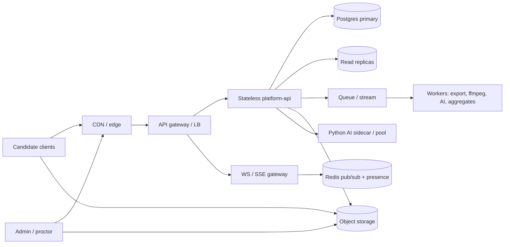

# System design: 100k concurrent candidates

Target: one exam, **100,000** candidates online at once. Same codebase for 50 and 100k; scale via replicas, sharding, and capacity profiles.

## Stack (this repo)

| Plane | Today | At XL |
|-------|-------|-------|
| Candidate UI | Vite `candidate-exam-app` + `@proctorshield/sdk` | CDN edge |
| Admin UI | Next `tenant-admin-portal` / `super-admin-portal` | CDN |
| API | Express `platform-api` (stateless) | HPA on RPS/p95 |
| AI | Python `:5055` ArcFace / detectors | GPU worker pool |
| DB | Postgres | partitions + replicas + PgBouncer |
| Cache | (optional Redis) | presence, thumbnails, aggregates |
| Media | local `storage/` / MinIO | S3 + CDN + SFU |
| Realtime | `ws` in API process | WS gateway fleet + Redis pub/sub |

## Architecture

## Planes (isolate failure)

1. **Exam delivery / answers (P0)** — never waits on proctoring, video, or reports.
2. **Telemetry / lockdown / violations** — batch ingest, ack fast, score async.
3. **Media** — direct-to-object-storage chunks + snapshots; SFU only for watched candidates.
4. **Admin monitoring** — exam-scoped lists, cursor pages, visible-tile subscriptions only.
5. **Reporting / exports** — replica/OLAP + background jobs.

## Capacity math (assumptions)

- Webcam ~150 kbps → ~135 MB / candidate / 2h → ~13.5 TB for 100k; with screen + snapshots ~20 TB.
- Peak ingest ~15 Gbps → **direct upload**, regional buckets.
- Snapshots: 100k / 20s ≈ 5k uploads/s.
- Heartbeats: 100k / 15s ≈ 6.7k req/s.
- Violation bursts: design 20–50k events/s with client batching.

## Data

- **Postgres:** partition `session_events` by exam/time; covering indexes for `(exam_id, created_at, id)` and risk sorts; **no OFFSET**.
- **exam_aggregates:** precomputed counters — exam list never `COUNT(*)` over 100k raw rows on the hot path.
- **Redis (planned):** presence, latest thumbnail pointer, live rollups, rate limits.
- **Object storage:** chunks, snapshots, exports (signed URLs).

## Live monitoring tiers

1. Always-on chunk recording (candidate).
2. Cheap snapshots + status WS for wall/grid (visible tiles only).
3. On-demand SFU / LL-HLS when a proctor opens or pins a candidate.

## Degradation L0–L4

| Level | Behavior |
|-------|----------|
| L0 | Full features |
| L1 | Slower thumbnail refresh |
| L2 | Lower bitrate; live video only for focused candidate |
| L3 | Snapshots only; coalesced status; exports delayed |
| L4 | Heartbeats + violations only |

Answer save stays up at every level.

## Priority lanes

P0 answer save → P1 critical violations / terminate → P2 status/thumbnails → P3 video chunks → P4 reports/transcode.

## Implemented vs planned (tracker)

See `docs/MASTER_PROMPT.md`. Phase 1 IA and foundations for risk/aggregates/exports/lockdown/media helpers are in-repo; Kafka/SFU/autoscaling remain planned.
